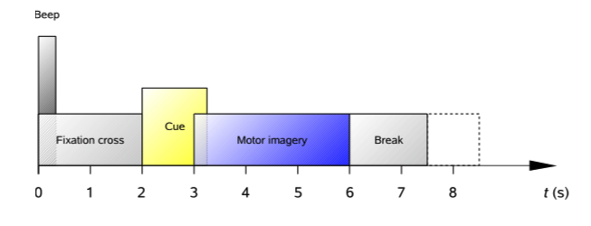
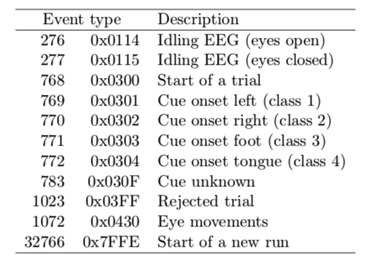

# BCI Competition Dataset IV 2a for python and numpy

This is a repository for BCI Competition 2008 dataset IV 2a fixed and optimized for python and numpy. This dataset is related with motor imagery. That is only a "port" of the original dataset, I used the original GDF files and extract the signals and events.

## How to use

You need to read the original paper [here](http://bbci.de/competition/iv/desc_2a.pdf). In that paper the authors explain the adquisition process. The dataset contain data about motor imagery of four different motor imagery tasks, namely the imagination of movement of the left hand (class 1),right hand (class 2), both feet (class 3), and tongue (class 4).

The form of each motor imagery task is like the figure below. (the figure was extracted for the original paper).

<p align="center">
    
</p>

Exist 9 subjects and for each subject one run that consists of 48 trials (12 for each of the four possible classes), yielding a total of 288 trials per session.

Each event (e.g. Start of Trial) is coded using the below table, this table was extraxted for the original paper.

<p align="center">
    
</p>

Please, for understand the complete work read the original paper [here](http://bbci.de/competition/iv/desc_2a.pdf).

### About this work

The current fileformat of these files are ".npz", for load this each file (e.g. A01T.npz) you can use numpy.load() command. Below you can see an example.

```python
import numpy as np
data = np.load('A01T.npz')
```

The names convention used for each datafile is the next:

-   's': contains all the raw data in a numpy array format.
-   'etyp': have all the events and its determinated type.
-   'epos': contains all the events position and its index is related with etyp and edur.
-   'edur': contains all the events duration.

### Data Loader

This repository provides a convenient data loader class `MotorImageryDataset` in `data_loader.py` to load and preprocess the data.

#### Installation

To use the data loader, you need to install the following dependencies:

```bash
pip install numpy
```

#### Usage

Here is an example of how to use the `MotorImageryDataset` class:

```python
from data_loader import MotorImageryDataset

# Load the data for subject 1, training session
dataset = MotorImageryDataset('.', subject=1, session='T')

# Get all trials and classes
trials, classes = dataset.get_trials()

# Get trials and classes for specific channels (e.g., C3, Cz, C4)
trials, classes = dataset.get_trials(channels=[7, 9, 11])
```

### One more complex example

In this example I've create a class with a method for extract all trials of one subject (AT01 in the example). Notate that try catch is here because some trial have a reject event, then with this try/catch I select only valid trials.

```python
from data_loader import MotorImageryDataset
from matplotlib import pyplot as plt

datasetA1 = MotorImageryDataset('.', subject=1, session='T')
trials, classes = datasetA1.get_trials_from_channels([7, 9, 11])


plt.subplot(3, 1, 1)
plt.imshow(trials[0])
plt.title('C3', size=22)
plt.subplot(3, 1, 2)
plt.imshow(trials[1])
plt.title('Cz', size=22)
plt.subplot(3, 1, 3)
plt.imshow(trials[2])
plt.title('C4', size=22)

plt.show()
```

## References

*   [Brunner, C., Leeb, R., Müller-Putz, G., Schlögl, A., & Pfurtscheller, G. (2008). BCI Competition 2008–Graz data set A. Institute for Knowledge Discovery (Laboratory of Brain-Computer Interfaces), Graz University of Technology, 1-6.](http://bbci.de/competition/iv/desc_2a.pdf)

## Contribute

If you want contribute please add a issue and I'll work in that. Thank for all.

<p align="center">
    
</p>
